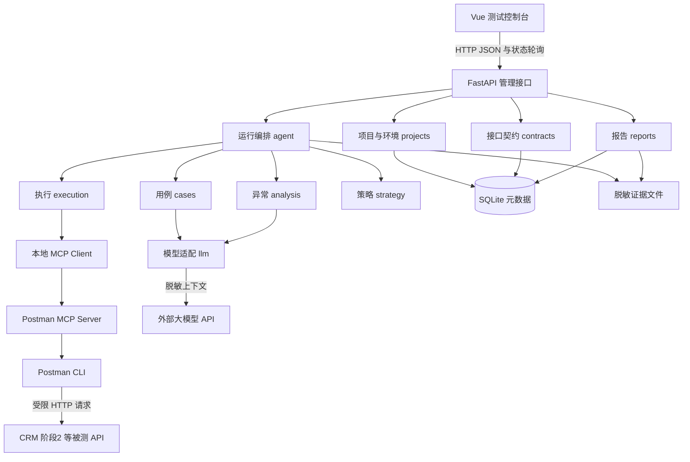

# 项目最终架构

> 更新于 2026-11-17。当前侧边栏分为接口管理、任务测试、项目、记录和设置。HTTP/SSE 归接口测试，WebSocket 调试独立保留，文档任务负责混合协议用例。项目页新增源码导入与接口文档生成，当前实现与限制见第 21 节。2026-11-03 的详细界面契约作为历史决策留存。
> 2026-10-27 已完成方案与架构复核，保留现有技术路线，并新增[开发实施契约.md](开发实施契约.md)。后者固定跨模块快照、状态、预算、证据与统计口径；阶段 1 的 1.2/1.3、Postman 执行基座、2026-11-01 控制台/长连接以及 2026-11-02 审核缺陷修复均已按该契约实现并通过验证。

## 当前实现与目标设计的界线

当前代码包含：
1. `backend/src/api_agent/`：
   - `main.py`、`cli.py`：应用入口与独立 CLI 命令；
   - `infrastructure/`：配置、日志脱敏、API 统一错误、ORM 基类（严格单调时间戳）、数据库引擎与迁移、目标回环策略（`targets.py`）；
   - `projects/` 提供项目管理、环境追加版本、源码扫描与快照、后台 AI 接口文档生成和导出。环境沿用乐观锁、多方法/路径与凭据变量引用。
   - `execution/`：结构化计划校验、**执行驱动抽象（`engine.py` 的 `TestEngine`）**、**原生 HTTPX 引擎（`native.py`）**、Collection v2.1 编译器、Postman CLI 隔离子进程运行器、JSON 报告归一化，以及界面执行路由（`POST /api/executions`、`GET /api/executions/engine/list`）；
   - `console/`：控制台手动 HTTP 请求发送与脱敏历史记录（`POST/GET /api/console/*`）；
   - `streams/`：WebSocket 调试探针、增量长轮询与历史回放（`POST/GET /api/streams/*`）；
   - `tasks/`：OpenAPI/Swagger 识别、确定性基线/边界用例生成、顺序执行、取消恢复和报告导出（`/api/tasks`）；
   - `llm/`：控制台动态大模型配置持久化（OpenAI 兼容协议）、连通性测试探活、可用模型清单拉取（`GET /models`）、支持工具调用声明的 chat 客户端；
   - `agent/`：AI 编排闭环——契约→用例生成、证据引用诊断、预算内单因素补测、后台运行与取消、脱敏 JSON 证据与 Markdown 报告（`/api/agent` 下共 8 个端点，含按执行 ID 的 `POST /api/agent/executions/{id}/diagnose`）；
   - `tools/`：官方 stdio MCP 服务（`api-agent-mcp`）与客户端。
2. `frontend/`：Vue 3.5 + TypeScript 5.9 + Vite 7 + Pinia + vue-router 前端控制台，提供 HTTP/SSE 接口测试、WebSocket 调试、文档任务测试、项目环境、历史、执行结果、设置；Iconify Lucide 选定图标本地打包，构建产物由 FastAPI 同源挂载。
3. 数据库包含五版 Alembic 迁移、共 8 张业务表。AI 运行和文档任务工件分别保存在 `ARTIFACT_DIR/agent/` 与 `ARTIFACT_DIR/tasks/`。项目源码快照及生成文档保存于 `ARTIFACT_DIR/projects/<project-id>/sources/` 和 `documents/`，由现有项目 ID 关联。

以下各节保留完整目标架构；除上述已实现能力外，均为后续设计。`contracts`、`cases`、`analysis` 等目录仍未创建（契约理解当前直接交模型，无确定性 OpenAPI IR）。
> 文件名中的“最终架构”表示项目的目标架构，不表示完整系统已实现。当前实际产物为项目文档、阶段 1 后端、独立 MCP/Postman 执行基座、Vue 3 前端控制台、长连接测试模块、`agent` AI 编排闭环、非秘密 CRM 样例及本机安装/隔离构建辅助脚本。

## 1. 需求依据与设计边界

用户已明确：围绕 API 文档解析、智能用例生成、自动执行、异常分析，构建异常反馈驱动的测试闭环，自主调整策略、补充用例和验证故障，输出可追溯报告。

用户已确认：本项目仅为课程设计；采用 Python + FastAPI + Vue 3；接受 OpenAPI HTTP JSON 子集和人工配置短依赖链；调用外部大模型 API；已有被测目标；当前只做本地部署。保留现有核心架构，优先体现 Agent 编排过程和 API 测试演示效果。

真实目标已指定为 CRM 阶段 2，Spring 8080 与 RAG 8000 的源码接口已核对；有效测试身份、RAG 依赖及模型供应商/型号仍留到相应步骤补齐。开发周期、调用预算和硬件未指定，不作为本次继续规划的前置条件；现有资源数值作为可调整的工程默认值。论文级实验、团队平台和生产部署不列入当前必交范围。

架构需要回答：

- 哪些测试步骤由确定性程序控制，哪些步骤适合交给大模型？
- 如何让“自适应”具有可解释的输入、动作、反馈和停止条件？
- 如何区分接口异常、测试构造错误、环境故障和模型猜测？
- 如何在缺少被测系统源码与日志时给出有边界的诊断？
- 如何把阶段、工具调用、观察与决策展示出来，并保留足够证据复查结论？

## 2. 已采用方案与选型依据

| 方案 | 组成 | 优点 | 代价及适用条件 |
| --- | --- | --- | --- |
| A：Python 模块化单体 + MCP，当前采用 | FastAPI + 显式状态机 + 本地 MCP + Postman CLI + SQLite + Vue | 保留现有管理和编排能力，复用 Postman 请求、集合与断言执行；测试产物可检查 | 新增本地进程和协议边界；CLI 兼容性、预算、取消和证据脱敏仍由本项目负责 |
| B：Python + 智能体图框架 | 上述方案加 LangGraph 等编排框架 | 复杂分支、人工介入和恢复需求出现后可评估统一编排 | 增加框架学习与状态语义适配成本；仍需实现测试判定、预算和证据链 |
| C：Java 平台 + Python 测试服务 | Spring Boot 管理端 + Python 智能测试服务 + 前端 | 适合已有 Java 系统或明确的团队技术要求 | 跨服务契约、部署和问题排查工作增加，不适合作为当前默认起点 |

当前按方案 A 规划实现；B/C 保留为选型比较记录。课程设计采用显式状态机串联生成、执行、分析与策略模块，满足编排展示需求。第一版无需引入微服务、消息队列、向量数据库或强化学习训练，后续出现明确需求时再评估扩展。

前端已确认采用 Vue 3，沿用 TypeScript + Vite 的配套方案，用于配置、表格、任务进度、编排轨迹和证据详情。具体依赖版本在实施时锁定。Vue 官方提供 TypeScript 与 Vite 集成说明：[官方文档](https://vuejs.org/guide/typescript/overview)。

## 3. 目标系统组成



图中的 SQLite 连线为简化表示；各业务模块通过自己的存储接口访问同一数据库，不直接读写其他模块的表来绕过业务规则。跨模块数据对象、API 公共结构、状态转换、预算账本和统计口径统一遵守[开发实施契约.md](开发实施契约.md)，避免各阶段形成不兼容的实现。

| 组成 | 目的与职责 | 技术如何应用 | 对外契约 |
| --- | --- | --- | --- |
| `projects` | 管理项目、环境、允许测试的目标和鉴权引用 | Pydantic 校验配置，SQLAlchemy 保存配置版本 | 提供经过校验的环境快照 |
| `contracts` | 解析文档，保存操作、参数、响应与来源位置 | 安全解析 JSON/YAML，版本适配与引用解析 | 提供 `SpecificationSnapshot`、`OperationSpec` |
| `cases` | 规则/模型生成、去重、负向意图标记、依赖绑定 | Pydantic 校验用例结构，稳定指纹排重 | 提供版本化 `TestCase` |
| `execution` | **执行驱动适配层（Execution Drivers）**：解耦测试内容与执行驱动，以注册表形式提供 `native`（原生 httpx 内存执行）与 `postman`（CLI 沙箱）两个可切换驱动 | 统一 `TestEngine` 协议（`name`/`status()`/`run()`），按 `engine` 参数分发；原生引擎复刻 Postman `atPointer` 语义保证判定一致 | 输入 `ExecutionPlan`，输出 `RunResult`；`executions.engine` 记录实际驱动；详见第 14 节 |
| `console` | 单次 HTTP 手动即时调试与历史审计 | `httpx.AsyncClient` 纯内存发包，严格数字回环校验，逐跳重定向清洗与脱敏落库 | `POST/GET /api/console/*` |
| `streams` | SSE 与 WebSocket 长连接探测、事件泵与时间线审计 | WHATWG 语法逐行流式解析、`websockets` 帧泵、原始字节硬上限截断、1.2s 增量长轮询 | `POST/GET /api/streams/*` |
| `tools` | **MCP 协议适配器**：向外部 Agent 暴露标准化受控 API 测试工具 | 官方 MCP Python SDK (stdio)，暴露 `postman_status`, `validate_plan`, `run_plan`，三者均接受可选 `engine` | 满足标准 JSON-RPC 2.0 stdio MCP 协议 |
| `analysis` | 提取异常事实、归类、签名去重和诊断 | 确定性分类与模型辅助解释 | 提供 `Finding`、`RoundSummary` |
| `strategy` | 选择动作、计算优先级、判断是否继续 | 可替换策略接口，先实现可解释启发式 | 输入轮次摘要和预算，输出 `StrategyDecision` |
| `agent` | 装配全流程、调度轮次、维护任务状态与预算（原 `runs/` 已于 2026-11-16 删除，其编排职责由 `agent` 承担） | 后台编排任务，运行证据以脱敏 JSON 落盘而非 SQL 表 | 提供编排任务 API、状态与事件序列 |
| `llm` | 统一模型服务配置与调用，提供 OpenAI 兼容适配 | 界面动态配置持久化至 SQLite、密钥三态（保留/覆盖/清空）、连通探活、`GET /models` 模型清单、函数/工具调用 | `GET/PUT /api/settings/llm`、`POST /api/settings/llm/ping`、`POST /api/settings/llm/models` |
| `reports` | 汇总统计、关联证据、生成展示与导出 | 查询模型 + JSON/Markdown 序列化 | 版本化 `Report` 与证据索引 |
| `infrastructure` | 初始化配置、数据库、目标安全白名单与结构化日志 | 共享连接管理、数字回环 IP 强制校验、敏感头脱敏 | 提供运行基础设施，不承担业务决策 |
| 前端 | 交互式操作、追踪运行、用例计划、长连接与 MCP 调试 | Vue 3 + TypeScript + Vite，炭灰暗色与白色蓝绿渐变双主题，可折叠侧栏和工作台分栏，FastAPI 同源托管 | 调用管理 API，不直连被测 API 或模型服务 |
| 演示样例 | 配合已有目标，稳定展示正常、负向、依赖链与反馈场景 | 目标联调配置、最小可重置样例、固定输入 | 准备/重置数据、展示补测与复现证据 |

模型不直接发送测试请求、不改变目标范围、不读取本地秘密，也不执行生成的 Python、SQL 或 Shell。运行编排器掌握流程控制权。

## 4. 文档解析与用例模型

### 4.1 第一版支持矩阵

| 项目 | 第一版支持范围 | 超出范围时的行为 |
| --- | --- | --- |
| 文档格式 | 单文件 OpenAPI 3.0.x、3.1.x，JSON/YAML | 其他版本与自然语言文档拒绝导入或明确标为待转换 |
| 接口 | HTTP 方法、路径、路径/查询/Header 参数、JSON 请求与响应 | 文件、流、回调和其他协议标为未支持，不静默忽略 |
| Schema | 基础类型、对象/数组、必填、枚举、数值和长度边界、单文件内部 `$ref` | 复杂组合、循环引用、未实现关键字标记受影响操作，禁止作完整契约结论 |
| 参数序列化 | 标量路径/Header 参数、查询 `form` 标量及明确定义的数组形式 | 其他 `style`/`explode` 组合列出未支持原因 |
| 鉴权 | 显式配置 Bearer Token、API Key 或固定 Header 引用 | 自动登录、刷新令牌和复杂 OAuth 流程后续评估 |
| 依赖关系 | 人工确认的有向无环短链，响应 JSON Pointer 提取变量 | 不凭字段相似度自动执行未确认的业务流程 |

导入结果包含错误、警告、可执行操作和被排除操作。任务只能选择支持范围内的操作；覆盖率分母明确排除哪些操作以及原因。

OpenAPI 3.0 和 3.1 的 Schema 语义不能混用。为 3.0 实现明确的适配层，处理如 `nullable` 等差异；3.1 按其声明且本项目支持的方言处理。Pydantic 校验的是系统自身的数据结构，不能替代所有被测 API 契约验证。依据：[OpenAPI 3.0.4](https://spec.openapis.org/oas/v3.0.4.html)、[OpenAPI 3.1.1](https://spec.openapis.org/oas/v3.1.1.html)、[jsonschema 验证器文档](https://python-jsonschema.readthedocs.io/en/stable/validate/)。

### 4.2 用例结构与生成边界

`TestCase` 表示一个测试场景，至少保存：ID、版本、操作引用、来源（规则/模型/反馈）、父用例与触发异常、测试意图、请求模板、变量依赖、断言、变异位置、预期违反的输入约束、生成器/提示模板版本和去重指纹。普通场景只有一个测试步骤；人工短链在同一用例内包含准备、测试、清理步骤及 DAG 依赖。一次 `CaseExecution` 对应用例的一次初始、补充或复现执行，每次实际网络发送另记 `HttpAttempt`；不能用一个执行记录覆盖多次请求或复现。字段关系见开发实施契约第 4～5 节。

建议生成顺序：正常基线 → 边界值 → 必填缺失/类型错误/枚举越界 → 用户确认的业务规则场景 → 针对异常的单因素补充场景。优先保留能解释测试目的的用例，避免无意义地组合全部参数。

区分两类校验：

1. **执行合法性校验：**用例结构、目标范围、方法权限、变量依赖、断言结构必须始终有效。
2. **被测输入契约校验：**正向用例应满足契约；负向用例可以在明确记录的字段上违反约束。不能把所有不符合输入契约的用例都过滤掉，否则边界和异常输入测试将失效。

模型提出的业务预期标记为候选；只有文档明确约束或人工确认的规则能作为判定业务缺陷的依据。模型不能同时凭空定义预期，再用该预期证明自己发现了缺陷。

## 5. 执行、判定与数据准备

### 5.1 执行流水线

每个用例按“准备依赖数据 → 绑定变量 → 校验目标和权限 → 原子预留请求预算 → 发起请求 → 保存脱敏证据 → 执行断言 → 清理临时数据”执行。准备和清理请求同样计入预算，任务开始时预留必要清理额度；额度不足时不创建需要清理的新数据。

依赖链示例：创建测试用户 → 从响应 `/id` 提取 `user_id` → 查询该用户 → 删除测试用户。变量在本次链内隔离。前置步骤失败时，后续用例标记为 `blocked`，不把缺失 ID 造成的连锁失败算作多个接口缺陷。

测试状态固定为 `passed`、`failed`、`error`、`blocked`、`skipped`、`cancelled`，场景聚合顺序见开发实施契约第 7 节。其中 `failed` 表示断言失败；`error` 表示执行或环境出错，两者都需要进一步归因，不能直接等同于产品缺陷。

### 5.2 判定顺序

1. 请求是否因 DNS、连接、TLS、超时或构造问题未取得有效响应？归入执行/环境异常。
2. 状态码、响应类型和响应结构是否符合该用例的预期？负向输入返回文档允许的 4xx 可以判通过。
3. 是否违反明确业务断言？例如金额应大于零、创建后查询结果应一致。
4. 是否满足用户配置的响应时间阈值？单次慢请求只表示性能异常候选，不推出系统容量或稳定性结论。
5. 仍无法确定时记录 `inconclusive` 诊断结论；由模型建议补充测试或人工复核。

文档与服务不一致时，可以确认“契约不一致”；若缺少其他证据，不能确定是哪一方错误。禁止自动按当前响应修改预期来消除失败。

真实目标请求的主执行路径已改为 Postman CLI，由本地 MCP 服务设置请求、脚本和集合截止时间，并增加宿主进程的整体截止与取消处理。HTTPX 可用于管理 API 测试及未来模型适配，不再作为并列的目标请求主执行器。CLI 的输出格式与可用选项必须按安装版本验证，不把进程成功退出直接等同于断言通过。详见第 14 节。

## 6. 异常分析与故障验证

### 6.1 异常分类

| 类别 | 证据示例 | 下一步建议 |
| --- | --- | --- |
| 环境/连接异常 | 无响应、连接错误、TLS 失败 | 校验环境；符合条件时有限重试 |
| 鉴权/配置问题 | 已配置身份仍返回 401；鉴权引用缺失 | 核对配置，不直接生成漏洞结论 |
| 契约不一致 | 响应字段缺失、类型不符、未声明状态 | 保存文档位置和具体断言差异 |
| 业务规则异常 | 明确规则下金额、库存或状态不满足预期 | 隔离变量、准备数据并复现 |
| 稳定性候选 | 相同输入偶发 5xx 或超时 | 受限重复与对照，记录成功和失败次数 |
| 用例/依赖问题 | 无效变量、错误前置条件、模型引用不存在字段 | 修正或拒绝用例，不归入被测系统缺陷 |

异常签名由操作、失败断言、关键字段和响应特征构成，用于聚类。签名相同只表示可能属于同一问题；真实独立缺陷数在实验中通过缺陷真值或人工核验确认。

### 6.2 事实、推断与证据

每个 `Finding` 分别保存已观测事实、诊断假设、证据引用、复现状态和待补充信息。展示标签为“待验证”“可复现异常”“未复现”“信息不足”等；模型的自评置信度不当作经过校准的概率。

没有服务端代码、日志或追踪信息时，系统可以指出触发条件和可能原因，但不能宣称定位到了具体源码行或数据库根因。报告优先描述“观察到什么、与哪条约束冲突、如何再现”。

对单个候选问题建议最多追加两次复现尝试，所有请求计入预算。只对明确允许重放的幂等操作自动重试；创建、支付、删除等有副作用操作必须使用可重置环境、受控准备/清理或显式重放许可。重复执行证据不能被第一次失败覆盖。

## 7. 自适应测试策略

### 7.1 定义与状态

第一版采用“反馈驱动、可解释的启发式策略”，不预设需要训练强化学习模型。智能体的自主性体现为：在用户确定的范围与预算内，根据观测选择后续测试对象、输入变异、复现动作或结束运行。

策略输入包括：已测试操作、已覆盖的参数场景、失败与环境错误、异常签名、复现结果、已执行用例指纹、剩余预算。输出 `StrategyDecision`，保存动作、目标、触发证据、理由、优先级分量与预期覆盖变化。

建议动作集：`expand_boundary`（边界细化）、`mutate_field`（单字段变异）、`verify_finding`（异常复现）、`cover_gap`（补充覆盖）、`stop`（结束）。大模型可提供候选输入；最终动作与资源分配由策略和编排器决定。

### 7.2 初始优先级规则

先筛除重复、不可执行、越界、前置条件不满足和预算不足的候选，再对余下候选排序。初始评分建议为：

`score = 0.30 × 异常价值 + 0.25 × 覆盖缺口 + 0.20 × 复现必要性 + 0.15 × 用户风险权重 + 0.10 × 输入新颖度`

各项取 `[0, 1]`。初版异常价值按失败类别固定映射（已确认业务规则冲突/5xx 候选为 1，契约差异为 0.7，环境错误为 0）；覆盖缺口按目标操作支持场景中尚未测试的比例计算；有未完成验证的异常时复现必要性为 1；用户风险权重默认 0.5；新颖度按新增“操作、字段、变异类别”组合占比计算。并列时按稳定 ID 排序。

这些是**待验证的设计参数**，不是研究结论；当前沿用为可调整的工程默认值，联调时根据实际效果修正并记录版本。若以后执行正式对照，再用独立开发样本调参并冻结。环境错误由独立的有限重试规则处理，避免其反复占据异常优先级。

### 7.3 多轮流程与停止条件

第 0 轮执行初始用例；后续最多执行 3 个补充轮次，每轮从候选池选择不超过 5 个补充用例。每轮结束后归类、更新覆盖、生成并记录决策，再决定是否进入下一轮。

以下为建议初始预算，不代表已经过容量验证：

| 项目 | 建议初值 | 计算口径 |
| --- | --- | --- |
| 被测 HTTP 请求 | 200 次/任务 | 包含准备、清理、重试、补充测试和故障复现 |
| 模型调用 | 12 次/任务 | 包括失败调用、格式修复和重试；每次有独立输出长度限制 |
| 任务总时长 | 15 分钟 | 包含生成、执行、分析与清理；报告整理需有独立短截止时间 |
| 补充轮次 | 最多 3 轮 | 不含第 0 轮；复现发生在所属轮次内 |
| 并发 | 1 个运行任务；链内串行 | 独立请求初始也串行，实测后再开放受限并发 |
| 无新增进展 | 连续 2 个补充轮次 | 都未增加有效场景覆盖、异常签名或复现证据时停止 |

没有有效候选、HTTP 硬预算到限、用户取消或连续无进展时停止普通测试；模型额度到限只停止新模型调用，保留规则执行与确定性策略，并记录退化。单个异常复现完成只结束该异常的验证，不自动结束整个任务。设置目标速率上限，并在达到普通工作截止时间前停止发起新请求，使用预留的清理额度和有限清理/报告窗口。清理失败或中断必须在报告中列出遗留资源。

### 7.4 闭环示例

文档规定 `quantity >= 1`，初始负向用例以 `quantity = 0` 测试，实际得到 500。系统先记录“异常输入触发服务端错误”，不猜测具体内部根因；再选择 `-1、1、2` 等邻近值作单因素对照，并在干净环境下验证原输入。报告关联初始失败、策略选择、补充用例和复现结果。

该示例仅为目标行为说明，尚未执行。

### 7.5 课程演示中的 Agent 编排

编排器通过结构化运行状态连接“读取契约 → 生成用例 → 选择动作 → 调用执行器 → 观察结果 → 分析异常 → 继续补测或停止 → 汇总报告”。生成器、执行器、分析器和策略器作为职责清晰的节点，通过输入/输出契约协作。

每个节点记录开始/结束时间、状态、输入摘要、工具名称、实际输出或错误、关联证据与预算变化。Vue 运行详情以阶段进度和事件时间线展示轨迹；每个补测节点都能展开看到触发异常、决策理由、生成用例和执行结果。循环必须由实际观测驱动，演示轨迹来自运行记录。

课程展示重点：同一任务中既能看到“工具执行了什么”，也能解释“为什么选择下一步”。基础节点编排和一次完整异常反馈即可体现核心能力，无需扩充为多个独立服务或训练新模型。

## 8. 大模型接入与退化路径

- 统一接口包含 `generate_cases(context, budget)` 与 `explain_findings(evidence, budget)`；实现时补齐具体类型与供应商能力映射。
- 输入仅包含必要文档片段、已确认业务规则、脱敏证据与剩余任务约束；不上传完整数据库或无关响应。
- 采用结构化 JSON 输出；无论供应商是否提供结构化能力，都再次做本地结构、引用、权限和重复校验。
- 首次输出无效时最多进行一次格式修复；仍无效则拒绝该批用例，保存失败原因。修复消耗模型调用预算。
- 模型限流、超时或不可用时保留已生成的有效用例，退化为规则模式，运行与报告显著注明退化及实际模式。
- 已确认通过外部 API 接入大模型；第一版实现一个选定供应商的真实适配器，另有确定性模拟器。模型标识、参数、模板版本、调用耗时和可获取的 token 用量写入记录。
- 如果供应商不返回 token 用量或没有可靠价格表，费用标记为未知或估算，并记录依据。不能把未知费用记成零。

外部 API 的接入方式已确认，厂商和模型型号留到联调前补充，当前不申请密钥。选择具体服务时根据结构化输出质量、中文分析能力、调用成本、上下文限制与数据处理要求实测决定。

## 9. 核心数据与可追溯性

| 数据对象 | 关键内容与关联 |
| --- | --- |
| `Project` / `Environment` | 项目、目标原点、方法/路径范围、鉴权引用及配置版本 |
| `Specification` / `Operation` | 原文哈希、版本、解析报告、操作与来源 JSON Pointer |
| `TestCase` / `Assertion` | 版本、测试意图、输入模板、断言依据、父用例与触发异常 |
| `AgentRun` / `Round` | 脱敏输入快照、模式、状态、预算账本、轮次与终止原因；以 JSON 证据落盘，不建 SQL 表 |
| `CaseExecution` / `HttpAttempt` | 用例版本、执行类型/复现序号、步骤、每次请求序号、脱敏证据、时长与错误 |
| `AssertionResult` | 每条断言状态、依据、实际证据和差异；截断导致无法判断时单列 |
| `Event` / `BudgetLedger` | 运行内递增事件、工具与决策摘要；各类资源的预留、消耗和释放流水 |
| `Finding` | 异常签名、事实、假设、人工核验、复现状态及证据列表 |
| `StrategyDecision` | 轮次、候选、选择理由、评分、未选原因与预算变化 |
| `ModelCall` | 模型/模板版本、脱敏输入输出、校验结论、耗时与用量 |
| `Report` | 报告版本、统计口径、发现索引、证据清单与文件哈希 |

证据链至少能按以下方向追踪：

`文档快照 → 操作 → 用例版本 → 实际执行 → 断言差异 → 异常 → 策略决策 → 补充/复现执行 → 报告`

SQLite 存结构化元数据和关联；较大的响应片段、模型记录与报告存本地文件，通过受控相对路径和哈希引用。响应大小与存储上限需配置，截断必须标记；无法完成完整响应校验时不能报告“完整契约验证通过”。凭据不进入快照，重放依赖重新提供对应本地秘密引用。

运行输入采用版本快照；执行记录追加保存，结束后的报告更新生成新版本。保存随机种子、目标版本、依赖锁和模型配置，支持**重放已保存用例**。外部模型重新生成不保证逐字相同，不能把记录种子描述为完整可重复生成。

SQLAlchemy 用于 ORM 和数据访问，Alembic 用于模式迁移；初版使用短事务，不能在等待 HTTP/模型响应期间持有数据库事务。ORM 能力参考[SQLAlchemy 2 官方文档](https://docs.sqlalchemy.org/en/20/orm/)。更换 PostgreSQL 仍需迁移与并发验收，不承诺只改连接串即可完成扩展。

## 10. 管理 API、前端与任务生命周期

### 10.1 管理 API 基线

| 接口 | 作用 |
| --- | --- |
| `POST /api/projects` / `GET /api/projects` | 创建项目、分页查询项目 |
| `GET /api/projects/{id}` | 查询项目及可用环境/文档摘要 |
| `POST /api/projects/{id}/environments` | 创建目标环境与范围配置 |
| `GET /api/projects/{id}/environments` / `GET /api/environments/{id}` | 查询环境列表与指定版本 |
| `PUT /api/environments/{id}` | 以 `expected_version` 追加环境版本，不覆盖旧版本 |
| `POST /api/projects/{id}/specifications` | 上传文档并返回解析报告 |
| `GET /api/specifications/{id}` | 查询文档快照、哈希和完整导入报告 |
| `GET /api/specifications/{id}/operations` | 查询操作、支持状态与约束 |
| `POST /api/projects/{id}/rulesets` / `POST /api/projects/{id}/chains` | 保存带版本的人工业务规则、短链及准备/清理配置 |
| `POST /api/executions` | 提交 `ExecutionPlan` 与可选 `project_id`/`engine`，同步执行并返回逐用例、逐断言结果；计划被拒绝时 400，执行结果（含失败）一律落库 |
| `GET /api/executions` / `GET /api/executions/{id}` | 分页查询执行历史与单次执行详情 |
| `DELETE /api/executions/{id}` | 删除一条执行历史；只删回看记录，不影响目标状态或 AI 编排证据，不存在返回 404 |
| `GET /api/executions/engine/list` / `GET /api/executions/engine/status` | 列出已注册引擎与服务端默认值；探测指定引擎可用性 |
| `DELETE /api/streams/{id}` | 删除一条长连接会话；在跑的会话先收尾再删，事件随 `CASCADE` 一并删除 |
| `DELETE /api/agent/runs/{id}` | 删除一次编排运行的证据文件；运行中返回 409，须先取消 |
| `POST /api/agent/executions/{id}/diagnose` | 依据执行时冻结的计划做证据诊断 |

路径与对象为实施基线，具体请求/响应通过 FastAPI OpenAPI 契约固定。列表分页、UTC 时间、错误结构、状态码和 `Location` 等公共规则见开发实施契约第 2 节。FastAPI 支持 OpenAPI 与 Pydantic 集成：[官方说明](https://fastapi.tiangolo.com/features/)。

### 10.2 调度与状态

手工计划执行（`/api/executions`）是同步的：请求内完成全部受控请求与断言比对后返回逐条结果，不存在排队态。AI 编排（`/api/agent/runs`）是后台任务，返回 202 与 `Location`，状态为 `queued → running → completed / failed / cancelled / interrupted`；前端以 1 秒间隔轮询查看进度，当前最多 4 个任务并行。

编排任务的重启语义：启动时把遗留的运行标记为 `interrupted`，不自动重放有副作用的请求；在途的模型调用按已消耗计入预算，因为请求可能已经到达供应方，不能冒充确定失败或自动重发。取消时停止新轮次，等待当前有截止时间的调用返回，保存已有部分证据与报告。第一版不承诺执行到一半自动续跑。

模拟任务模块（原 `runs/`）已于 2026-11-16 删除：它的动作是本地 `asyncio.sleep`，从不访问目标，只验证调度器可靠性而不产生测试证据；其五张表随迁移 `20261105_0005` 一并删除。原状态机中 `running → cancelling → cancelled` 的中间态与 `dispatch_attempts` 的在途尝试概念不再适用。

### 10.3 前端页面

当前实际页面为：接口测试（`/request`，HTTP/SSE）、WebSocket 调试、文档任务测试（`/testcases`）、项目环境、请求历史、执行结果和系统设置。任务页展示用例来源、协议、断言和有界证据，并允许导出总结。

## 11. 执行范围、数据与部署

这些限制属于测试系统自身的执行设计：

- 每次任务固定被测原点、允许方法与路径；模型不能扩大范围。默认不自动跟随重定向；每次实际请求前复核范围和目标地址。
- 本地/内网测试必须显式允许相应目标；校验域名解析结果与实际连接目标，防止借重定向或解析变化访问未授权地址。模型服务使用单独的地址配置。
- 单文件导入只允许内部引用，禁止远程 `$ref` 和本地文件读取；限制文件大小、嵌套深度和引用展开规模，安全处理 YAML。
- 文档描述、响应文本均视为数据；其中出现的指令不能改变系统策略。响应和模型文本进入页面或 Markdown 时按数据转义。
- 目标令牌、Cookie、API Key 和个人数据在持久化、日志、模型输入与报告各入口统一脱敏；为敏感字段提供配置规则。
- 本地管理服务默认绑定回环地址。若未来向公网或团队开放，先增加管理端身份验证、权限隔离、HTTPS 和数据保留策略，再允许暴露。

当前仅做本地部署：本机启动 FastAPI 后端与 Vue 前端，SQLite 和脱敏证据保存在本地目录。开发时前端通过本地开发代理访问后端；本地演示打包时可由 FastAPI 同源提供构建后的静态资源。提供启动、停止、健康检查、持久化与演示重置说明即可。

已有被测系统作为主要联调目标，通过其已配置地址访问；本地部署不限制该目标必须与本项目同机。外部模型通过网络 API 调用。Docker/Compose、云服务器和公网访问均为后续可选扩展，不是本次课程设计的完成条件。

## 12. 效果评估与项目完成标准

### 12.1 课程演示与必需验收

优先选择用户已有目标中少量有代表性的接口，演示正常请求、合法负向输入、人工配置的短依赖链，以及一次“异常 → 分析 → 决策 → 补测 → 复现/未复现 → 报告”的完整过程。控制台应能逐步查看真实节点与工具调用，而不只是展示最终文本。

已有目标不保证存在稳定可触发的缺陷。为保证课程演示可重复，可以补充少量可重置的本地受控样例；报告明确区分真实目标发现和人工注入异常。无需另建完整业务系统、固定规模的缺陷集或重复统计实验才能完成课程验收。

必需检查：模型与被测目标真实联调、编排轨迹可见、补测有依据、请求范围和预算生效、短链变量能传递、报告能追溯证据，以及按 README 在本机重现演示。

### 12.2 可选对照设计

若后续需要更充分的效果分析，可加入以下对照；实验目标、缺陷规模和重复次数根据新增要求确定，不设为当前硬性交付条件。

| 组别 | 配置 | 回答的问题 |
| --- | --- | --- |
| A：规则静态 | 固定规则候选与顺序，无结果反馈 | 确定性基础能力如何？ |
| B：规则 + 大模型静态 | 初始生成候选，执行过程中不按结果补充 | 大模型补充本身带来多少变化？ |
| C：规则 + 大模型 + 自适应 | 与 B 共用初始用例，再按反馈选择补充与验证 | 相比 B，反馈策略有何实际收益与成本？ |

各组使用相同目标版本、数据重置方式、允许范围、HTTP 请求预算和时间上限；B/C 使用相同模型与模型调用上限。B 的后续候选与执行顺序预先固定，C 可按结果调整；所有准备、重试和验证都计费。记录实际资源消耗，不能仅比较用例条数。通用故障复现规则对各组保持一致，避免只给 C 更多验证机会。

执行正式对照时，策略权重在开发样本上调整后冻结，评测样本不再调参；缺陷标签仅供独立评估，不进入生成提示或策略上下文。重复次数应与费用和样本规模一起确定，记录全部运行及离散程度，小样本不宣称普遍优越。

### 12.3 指标与口径

| 指标 | 计算口径与限制 |
| --- | --- |
| 操作覆盖率 | 已执行至少一次有效测试的操作数 / 本次纳入且可执行的操作数 |
| 场景覆盖率 | 已执行的“操作、字段、场景类别”组合 / 预先定义的可支持组合；不称为代码覆盖率 |
| 独立缺陷数、缺陷召回率 | 人工/真值确认的独立缺陷数及其占本次可触发缺陷总数的比例，不用异常条数代替 |
| 发现准确率 | 确认为缺陷的发现数 / 已核验发现数；信息不足的发现单列，不隐去 |
| 有效用例比例 | 可通过系统执行合法性校验并满足前置条件的用例数 / 生成总数；合法负向用例计入有效 |
| 首个缺陷时间与成本 | 从运行开始到首次获得经核验缺陷证据的时长、请求数；未发现时单列 |
| 反馈增益 | 相比共用初始用例，补充轮次新增的已核验缺陷、覆盖和复现证据 |
| 复现情况 | 按明确协议可再次触发的候选数、成功/尝试次数及未复现原因 |
| 资源开销 | HTTP 请求数、模型调用/token/可核算费用、总耗时和失败率 |

验收先要求闭环正确、证据完整、预算和范围限制有效，再检验效果。若 C 未优于 B，应如实分析原因；不能通过删除不利运行或更改指标定义制造提升。

本表保留统一统计口径供运行报告与后续评估使用。已有目标缺少完整缺陷真值时，缺陷召回率标为不可计算，不因课程演示完成而宣称已测得整体缺陷发现能力。

## 13. 风险、已确认决定与后续输入

| 风险 | 对策 |
| --- | --- |
| 大模型产生不存在字段或错误预期 | 结构/引用校验，业务预期需文档依据或人工确认 |
| 文档不完整导致误报 | 明确契约差异与待验证假设，保留人工补充约束入口 |
| 故障复现破坏目标状态 | 可重置环境、链内隔离、清理额度和受控重放 |
| 策略反复测试同类输入 | 稳定指纹、异常聚类、候选过滤和无进展停止 |
| 模型和网络开销掩盖收益 | 保存完整成本口径，B/C 同预算对照 |
| 前端和平台功能拖慢核心验证 | 先通过后端闭环，再开发完整控制台 |

2026-10-16 用户确认如下：

| 决策项 | 已确认内容 |
| --- | --- |
| 项目定位 | 课程设计，重点体现 Agent 编排与 API 测试演示效果 |
| 主技术栈 | Python + FastAPI + Vue 3 |
| 接口范围 | OpenAPI HTTP JSON 子集 |
| 流程测试 | 人工配置短依赖链 |
| 模型接入 | 外部 API |
| 被测目标 | 已有目标，后续补充连接信息与文档 |
| 部署 | 当前仅本地部署 |
| 核心方案 | 认可现有设计，后续再追加具体要求 |

相应实施步骤需要补充：外部模型供应商/型号和本地凭据引用；目标地址、接口文档、允许测试的操作、鉴权方式及短链准备/清理方法。当前无需用户一次性提供这些信息，也不把规划默认预算说成已测得的容量或额外确认要求。

2026-10-16 已按用户要求实施 1.1 后端骨架并安装锁定依赖，未发起模型或被测目标请求。2026-10-27 完成方案复核并补齐跨阶段契约，随后完成 1.2 数据库迁移与项目/环境 API、1.3 模拟任务队列与恢复语义；现有 47 项后端测试、Ruff、格式和锁文件检查通过，并以真实进程验证崩溃恢复与重启持久化。后续从阶段 2.1 继续推进，按实际变化同步 README、架构/契约与阶段计划。

## 14. 独立 API-Agent + MCP + Postman CLI（2026-10-29）

### 14.1 目标、已选方案与本次范围

用户指定 `<CRM_PROJECT_DIRECTORY>` 为真实测试目标，允许使用其中多种接口，并选择“独立 API-Agent + MCP + Postman CLI”。现有 Python/FastAPI、SQLite、任务生命周期和后续 Vue 方向保留。独立 Agent 自己管理计划、工具调用、观察、反馈和停止条件，运行时不依赖 Codex。

“轻量”在本项目中指专用于 API 测试：只有接口、用例、执行和结果工具，没有通用代码编辑、Shell、浏览器、仓库检索等 Agent 工具；模型按阶段接收有限、脱敏的结构化摘要。MCP 本身增加一个本地进程和协议开销，不承诺一定比 Codex 更快或更省 token；需要在完整模型闭环后按同任务、同预算测量。

选型比较：

| 方案 | 取舍 | 本次决定 |
| --- | --- | --- |
| 独立 API-Agent + 本地 MCP + Postman CLI | 能独立运行；工具边界可复用；增加 MCP 进程与结果适配 | 用户已选择 |
| 仅提供 MCP，由 Codex 等宿主编排 | 接入快，但测试策略与运行依赖宿主 | 不作为主体；未来可复用同一 MCP |
| Python 直接调用 Postman CLI | 少一层协议，但外部宿主复用时仍需另写适配 | 保留内部执行服务供 MCP 调用，不形成第二套执行逻辑 |

本次首个代码交付是**真实执行基座**：结构化计划、受控 Collection 编译器、本地 MCP 服务及独立客户端入口、CLI 适配、结果归一化、CRM 源码映射的样例与验证。模型生成、模型诊断、自适应补测、Vue 控制台沿原阶段逐步完成；确定性执行入口不能标成完整大模型 Agent。

### 14.2 组成与数据流

1. `execution/schemas.py`：计划、请求、断言、范围、预算及结果类型；不接受任意脚本或 CLI 参数。
2. `execution/collection.py`：将已校验计划编译成项目生成的 Postman Collection v2.1 JSON。第一步固定 v2.1，以便使用 JSON reporter；不自动接受 v3 YAML 或任意第三方 Collection。
3. `execution/postman.py`：解析受信的本机 CLI 路径，使用参数数组启动进程，控制超时/取消，读取临时报告并归一化结果。
4. `execution/service.py`：统一校验、执行及脱敏结果出口；MCP 和后续管理 API 共用，不复制实现。
5. `tools/server.py`：基于官方 MCP Python SDK 的 stdio 服务，只公开固定 API 测试工具。
6. `tools/client.py` 与命令行入口：启动本项目的 MCP 子进程，初始化会话，调用工具并输出 JSON。先提供 `doctor`、计划校验、计划执行；将来由 `runs` 复用客户端。
7. `examples/crm/`：非秘密计划与接口清单。真实 CRM 源码保留原目录，不迁入、不改写。受控 HTTP 样例只验证执行器，不能代替 CRM 实测。

数据流为：结构化计划 → MCP Client → MCP Server → 校验与 Collection 编译 → Postman CLI → 被测 API → JSON reporter → 脱敏归一化结果 → Agent/用户。模型阶段追加在计划生成、摘要分析和补测选择处；模型不得绕过执行服务直接调用任意命令。

### 14.3 MCP 工具与输入边界

| 工具 | 输入 | 输出与副作用 |
| --- | --- | --- |
| `postman_status` | 无 | CLI 是否可用、版本和执行能力；不登录、不安装、不请求目标 |
| `validate_plan` | 结构化 `ExecutionPlan` | 支持项、请求数量、校验失败原因；不发请求 |
| `run_plan` | 结构化 `ExecutionPlan` | 每次请求、断言、整体状态与耗时；仅执行计划内请求 |

工具不接收任意文件路径、Shell、脚本、Collection ID、Postman workspace ID、可执行文件路径或自由 CLI 参数。CLI 路径由本机配置决定，模型不能更改。MCP 使用 stdio，不新增公网监听；stdout 只承载协议，诊断写 stderr。

第一步计划显式给出一个 HTTP origin、允许的方法和路径、请求列表、断言以及预算。服务端还需用本机配置限制允许 origin；计划不能自行扩大授权。初始支持回环地址，域名和远程目标在验证连接地址策略后再扩大。禁止重定向，默认 TLS 验证，不继承目标代理；目标 URL 由服务端拼接。拒绝绝对请求 URL、路径穿越、未绑定变量、Host 覆盖和未支持的输入。

请求体仅 JSON，断言采用固定类型：HTTP 状态、JSON Pointer 值/存在性、响应类型和可选时间阈值。只由程序模板生成有限 `pm.test/pm.expect`，将用户文本编码为数据；不执行用户/模型 JavaScript，禁止隐藏请求和动态跳转。第一步不承诺自动登录、动态提取变量或完整状态化短链；鉴权经本机环境变量引用注入，值不进入 MCP 输入输出。

### 14.4 CLI、报告、预算和取消契约

- 使用官方 Postman CLI，不用 Newman 静默替代；缺少 CLI 时明确返回 `cli_unavailable`。CLI 安装在项目内可重现工具位置或使用明确的本机路径，避免修改全局 Agent 指令、自动安装插件或代用户登录。
- 按已验证 CLI 版本使用 `collection run`、`--reporters json`、`--reporter-json-structure newman`、受控报告路径、请求/脚本/集合超时、`--ignore-redirects`、`--no-insecure-file-read`、`--no-report-events`。实际可用选项以本机 `--help` 与实测为准；不以 `--working-dir` 作为隔离措施。
- 使用本地未关联云端的 Collection，在隔离工作目录运行；不执行 `init/login/push/publish`，不上传 CRM 源码、凭据或报告。子进程只继承运行必需环境和显式鉴权值，不继承 Postman 登录配置。
- 原始 Collection、鉴权环境和 reporter 均放临时目录，成功、失败和取消后清理；持久输出仅含经过白名单提取与脱敏的结构化结果。原始 stdout/stderr、响应体和断言错误消息不能直接透传到模型或管理 API。
- `ExecutionPlan` 设置最大请求数、单请求超时及总时限；编译器每个 item 只发送一次，固定一次迭代，不重试、不重定向、不允许脚本发请求。因此请求数上限可在执行前精确预留。启动后消耗需区分“已观测发送”和“无法确认”；不能简单将 item 数当作实测发送数。
- 独立执行入口与编排入口彼此分开，各自持有预算口径，不共用账本。在发起 MCP 执行前原子预留整批上限，按逐次证据结算；中断无法确认项保持未知，禁止重放副作用请求。
- 取消或总超时须终止实际 CLI 子进程并等待回收；Windows 需覆盖启动器及其子进程，避免停止 MCP 后仍继续请求。中断导致报告不完整时返回 `cancelled/timed_out` 和未知项，不能补写通过结果。
- 归一化区分 `passed`（断言通过）、`failed`（有效结果含断言失败）、`error`（启动/网络/报告异常）、`timed_out`、`cancelled`；CLI 非零退出仍可能有可用断言失败报告。报告缺失、损坏、执行数量不匹配和没有执行断言均不能判成功。

### 14.5 CRM 阶段 2 的实际接口与测试顺序

以下为 2026-10-29 源码核对结果，尚不代表服务已启动或接口已实测：

| 服务/接口 | 实际行为与测试重点 | 首步处理 |
| --- | --- | --- |
| Spring `POST /api/user/register` | JSON；姓名、邮箱、手机号、公司、密码及确认密码；有写入副作用 | 先测缺失/格式错误；有效注册使用独立测试账号，注明没有注销清理接口 |
| Spring `POST /api/user/login` | JSON；`email/password`；成功返回 `data.token` 等用户资料 | 缺参/非法邮箱负向；有效凭据通过本机引用提供，输出不含 token 或用户资料 |
| Spring `GET /api/customer/list` | keyword/pageNum/pageSize 查询；分页返回 | 未登录、无效 token；有测试 token 时查只读分页，不输出客户明细 |
| Spring `GET /api/customer/{id}` | 路径参数、详情 JSON | 未登录/无效 token；授权测试数据的详情与不存在 ID |
| Spring `POST /api/customer` | JSON 新增，不返回新 ID | 受控测试数据；需要按唯一测试标识查询确认 ID，不能凭创建响应猜测 |
| Spring `PUT /api/customer/{id}` | JSON 更新，有乐观锁相关行为 | 仅修改本次测试创建的数据；完整链留待变量绑定能力 |
| Spring `DELETE /api/customer/{id}` | 存在关联商机时拒绝；实际为 status=inactive 的软删除 | 验证状态变化，不能把删除后仍能查询直接判为缺陷；不清理其他业务数据 |
| Spring `GET /api/chat/ask/stream` | 查询参数 question，`text/event-stream` | 登记为 SSE；首步 JSON 执行器明确未支持，不计入覆盖 |
| FastAPI `GET /health` | JSON 健康检查 | 服务可用时做连通基线；与 API-Agent 的 /health 区分 |
| FastAPI `POST /ask` | JSON question，汇总模型回答 | 会调用目标模型服务；需目标依赖可用，返回文本只作数据 |
| FastAPI `POST /ask/stream` | SSE，含 `[START]` / `[END]` | 单独计划后续 SSE 适配，需验证事件顺序、首事件耗时、结束与取消 |

Spring 拦截器读取自定义 `token` Header，而非 `Authorization: Bearer`；登录/注册白名单，其余默认受保护。`GlobalExceptionHandler` 没有为参数或业务异常设置 HTTP 状态，因此可能是 HTTP 200 + `code="400"/"500"`；鉴权拦截器则明确 HTTP 401 + `code="401"`。测试须分别断言 HTTP 状态和业务码。业务码语义是否合理可列契约发现，但不能按通用 REST 习惯直接改写目标预期。

源码依据：`crm-backend/src/main/java/com/elcrm/{controller,dto,vo,common,interceptor,config,service/impl}` 和 `crm-rag-fastAPI/main.py`。默认 Spring 端口为 8080，FastAPI 直接运行默认 8000；后者与 API-Agent 默认端口冲突，联调时给 API-Agent 或 RAG 显式选择不同端口。真实目标尚未检测到监听；Java 可用，Maven 位于 `<MAVEN_HOME>`；Postman CLI 未在 PATH 中。不得从源码中的密钥、数据库配置或运行日志复制秘密到本项目。

### 14.6 验收、限制与后续阶段

首步验收：

1. 通过官方 MCP SDK 完成真实 stdio 初始化、列工具、校验和执行调用；不用普通函数调用冒充 MCP 集成。
2. 真实 Postman CLI 对本地受控 HTTP 服务执行：正常通过、预期负向通过、断言失败、连接失败、禁止重定向、超时、取消；校验报告格式及失败语义。
3. CRM 样例覆盖登录/注册参数验证、自定义 token 鉴权和不同路径/查询参数；真实 CRM 未启动或测试凭据不可用时如实登记，受控样例不混报为 CRM 联调。
4. 验证任意命令/脚本/越界 URL 无法从 MCP 入参进入执行；秘密不出现在结果、日志、持久文件和命令行中。
5. 运行现有完整后端测试、Ruff、格式和依赖锁检查；保留已通过的阶段 1 行为。

后续依赖顺序：真实执行基座 → 契约解析与规则用例 → 单供应商模型适配与结构化输出 → 异常事实/诊断 → 受预算约束的反馈补测 → 状态化短链、SSE 和 Vue 展示。SSE 是否可用先对安装版 CLI 做能力探测；若不能取得必要事件证据，则增加专用传输适配或保持未支持，不把完整 JSON reporter 当作流式验收。

官方依据（2026-10-29 查阅）：[CLI 集合命令](https://learning.postman.com/docs/postman-cli/postman-cli-collections/)、[JSON reporter 与 Newman 结构](https://learning.postman.com/docs/postman-cli/postman-cli-reporters/)、[CLI 安装](https://learning.postman.com/docs/postman-cli/postman-cli-installation/)、[官方 MCP Python SDK](https://github.com/modelcontextprotocol/python-sdk)。上述文档说明能力，不构成本机实测证据；本机实现与验证见第 14.7 节。


### 14.7 实际实现与验证（2026-10-29）

- `execution/{schemas,collection,postman,report,service}.py` 已实现受控计划、固定模板、原生 CLI 进程与 Newman 结构报告归一化；数值/JSON/路径等不支持项会拒绝。首步 `body: null` 表示不发送请求体。
- `tools/{server,client}.py` 使用官方 MCP SDK 2.3.0，正式入口为 `api-agent-mcp`；独立 `api-agent doctor/validate/run` 实际启动子进程并使用 MCP 协议。
- 原生 Postman CLI 1.82.0 及其必要 lib 依赖安装于项目 `.cache/tools/postman/`，安装包通过官方 npm SHA-512 检查；未运行 npm postinstall 或更改全局 Agent/MCP 配置。现有 npm 启动器缺少平台包，因此没有将其当作可运行 CLI。
- Windows 运行过程使用 Job Object，正常取消/整体超时与子进程回收已测试。集合、原始报告和最小用户配置目录在执行后清理；返回只包含白名单元数据。
- 新增 `TARGET_AUTH_ENV_VARS` 本机许可名单，不能由计划引用任意环境秘密。未配置凭据不会尝试登录。
- 最终完整后端测试 105 项通过（99.72s）；真实 CLI 的通过/失败/连接错误/重定向/超时/取消和真实 stdio MCP 全链路均在其中。最终复核结果以阶段记录为准。
- CRM 原源码只读，隔离构建并在 127.0.0.1:8080 启动真实 Spring 服务；经正式独立命令执行 `examples/crm/smoke.json`，8 请求/16 断言通过，未知请求 0。脱敏报告为本机 `data/artifacts/crm-smoke-2026-10-29.json`；测试 Java 实例已停止，没有注册账号或新增/修改/删除客户。
- 有效身份/数据库业务、RAG 运行和 SSE 尚未验收；客户软删除语义只依据源码整理。目标流接口前置 JSON 错误的样例不构成 SSE 支持。
- 本次没有模型调用、完整 Agent 反馈、前端、提交、推送、部署或对外连接；工作目录本身没有 Git 元数据。

最终审阅修复已验证：预期 JSON 经 JSON.parse 恢复、受限数字精度、规范数组索引和 Header 名称规范化。修复后重新启动隔离的真实 CRM，正式独立入口再次取得 8 请求/16 断言全部通过（约 6.42 秒、unknown=0），随后停止本次 Java 实例。Ruff、格式和依赖锁检查通过，原始执行临时目录为空。

### 14.8 执行驱动与协议适配器模式 (Driver / Adapter Pattern)

为避免业务上层（编排器、控制台、MCP 服务）与具体的发包执行技术深度耦合，系统在 `execution` 模块确立了**驱动适配器模式**，并已落地为**可切换的双引擎实现**：

```text
       【上层调度源】REST /api/executions、MCP run_plan、CLI api-agent run
       请求体均接受可选字段 engine = "native" | "postman"（缺省 native）
             │
             ▼
       【执行服务门面】ExecutionService
       - parse(): 计划结构校验 + 本地数字回环白名单（不可被模型改写）
       - resolve_engine(): 驱动注册表查找，未知名称 → unknown_engine
       - engines = { "native": NativeHttpEngine, "postman": PostmanRunner }
             │
             ├─────────────────────────────────────────────────┐
             ▼ engine=native                                   ▼ engine=postman
┌───────────────────────────────┐               ┌───────────────────────────────┐
│     NativeHttpEngine          │               │     PostmanRunner             │
│     (execution/native.py)     │               │     (execution/postman.py)    │
├───────────────────────────────┤               ├───────────────────────────────┤
│ • 基于 httpx.AsyncClient      │               │ • 编译受控 Collection v2.1    │
│ • 纯内存执行，延迟 < 30ms     │               │ • 隔离临时工作区 + 环境变量清洗│
│ • 零外部二进制安装依赖        │               │ • Windows Job Object 进程树杀 │
│ • 不适合/不需要 Newman 报告   │               │ • Newman JSON reporter 归一化 │
└───────────────────────────────┘               └───────────────────────────────┘
             │                                                 │
             └────────────────────────┬────────────────────────┘
                                      ▼
                   【统一归一化输出】RunResult(engine, status, executions[])
```

1. **抽象契约**（`execution/engine.py` 的 `TestEngine` Protocol）：
   - `name: str` —— 驱动标识，写入 `executions.engine`；
   - `async status() -> dict` —— 本地就绪探测（原生恒可用；CLI 执行 `--version`）；
   - `async run(plan, secrets) -> RunResult` —— 执行并返回归一化结果。
2. **断言语义对齐**：原生引擎在 `_evaluate_assertion` 中逐条实现 `status`、`content_type`、`response_time`、`json_equals`、`json_exists`；`evaluate_pointer` 严格复刻 Postman 的 `atPointer`（数组下标仅接受规范十进制、越界与 `length` 均视为不存在、`~0`/`~1` 转义），因此同一份计划在两个引擎下判定一致。
3. **核心价值**：
   - **内容与驱动解耦**：测试用例、断言逻辑仅表达“测试什么（What）”，底层引擎仅负责“如何发包与比对（How）”。
   - **极速与背书兼备**：原生驱动消除子进程拉起与文件读写的固定延迟，且在无 Postman 环境（CI/容器/Linux）下可直接工作；Postman CLI 保留为权威工业标准的客观裁决与防作弊背书。
   - **协议适配外延**：`tools/server.py` 作为 **MCP 协议适配器**，把驱动能力标准化包装为 `postman_status`、`validate_plan`、`run_plan` 三个纯数据工具，三者均接受可选 `engine` 参数；任何支持 MCP 的宿主（Claude Desktop、Cursor 等）均可即插即用。
4. **界面对接**：`GET /api/executions/engine/list` 返回两个驱动的就绪状态，前端「用例计划」页据此渲染引擎下拉框与状态芯片，执行时把所选 `engine` 随计划一并提交。

---

## 15. 前端控制台与长连接流引擎架构 (Frontend & Stream Engine Architecture)

### 15.1 前端控制台架构与同源托管

1. **技术栈与界面规范**：
   - Vue 3.5 + TypeScript 5.9 + Vite 7 + vue-router + Pinia，图标库统一为 `lucide-vue-next`。
   - 全局语义变量由 `styles/tokens.css` 管理，默认暗色采用炭灰表面、细边框和灰色渐变，亮色采用白色表面与蓝绿渐变。共享按钮、输入、标签页、表格、卡片、弹窗及状态颜色随 `html[data-theme]` 切换。
   - 分组侧栏宽 248px，折叠后宽 72px，顶栏高 60px。导航行、图标、分组标题与底部两行操作保留固定高度，折叠通过宽度变化和文字渐隐完成。图标入口保留可访问名称与悬浮提示。
   - `lib/appearance.ts` 统一读取和保存 `api-agent.theme`、`api-agent.sidebar-collapsed` 浏览器偏好；HTML 头部提前恢复主题，Vue 挂载前再次同步。存储不可用时允许在当前页面继续切换，减少动态效果偏好会缩短过渡。
2. **同源挂载与 SPA 回退**：
   - 前端构建产物 `frontend/dist` 由后端 FastAPI 在 `/assets` 静态挂载，非 `/api` 的前端路由回落到 `index.html`（HTML5 History 模式）。
   - 浏览器直接访问 `http://127.0.0.1:8010/` 即可使用，无需独立启动前端 Vite 开发服务器。
3. **三个测试页统一为「左历史 + 右功能区」**：`/request`、`/testcases`、`/long-connection` 共用 `TestWorkspace` 外壳与唯一的 `HistoryList` 历史列；`/testcases` 的手动与自动模式共用同一份历史（合并、按时间倒序、标题固定为「测试历史」），切换模式只替换右侧内容，历史列宽度、滚动位置与列表内容均不变化。历史列支持双向拖动、最小阈值与独立持久化键，条目统一为两行布局并可通过 `#prefix` 插槽注入页面特有标记。删除与清空由组件自身渲染，经可选回调 `onDelete` / `onClear` 启用：不传即完全不渲染，`@click.stop` 由组件保证，避免调用方各自复制按钮或忘记阻止冒泡导致「点删除顺带选中」。删除按钮常驻而非悬浮才出现：按钮高 18px 高于文字行高约 15.3px，用 `display` 显隐会把首行撑高再缩回，使记录在悬浮时跳动；改为常驻 + `opacity` 弱化，既稳定高度又保持列表可扫读。
4. **系统设置页集成测试引擎选择器与 MCP 服务详情**：
   - 在 `/settings` 系统设置中以**卡片式引擎选择器**呈现可选执行引擎：每张卡片显示名称、类型（内置 / MCP 服务 / 外部导入）、传输方式、版本与实时就绪状态（绿点 / 红点 + 错误码）；末尾提供「导入引擎」入口，当前仅界面占位、未实现导入逻辑。
   - 选定结果写入 `localStorage` 的 `api-agent.engine`，「用例计划」页据此默认选中，实现两处共享同一选择。
   - 设置页是长表单，根容器必须可纵向滚动（块级 + `min-height: 100%`），否则大模型密钥、模型列表与退出按钮会落在视口外且不可操作。
   - 同一卡片下方保留内置 **`postmanmcp`** 服务详情：工具清单（`postman_status` / `validate_plan` / `run_plan`）、启动命令，以及 Claude Desktop / Cursor 的标准接入 JSON（一键复制）。
4. **大模型配置能力**：
   - **密钥生命周期**：`PUT /api/settings/llm` 区分三态——`api_key` 缺省/`null` 保留原值、非空字符串覆盖、空字符串显式清空；界面提供「清空密钥」按钮与「已保存有效密钥」徽章，永久不回显明文。
   - **模型清单**：`POST /api/settings/llm/models` 接受未保存的预览 `base_url`/`api_key` 或回落到已存配置，由 `OpenAIClient.list_models()` 向 `{base_url}/models` 发起 `GET`，解析 `data[].id`（兼容 `models[]` 与裸列表形态），去重排序后返回；鉴权失败与非法 JSON 分别映射为可读提示而非 500。
   - **交互闭环**：界面「获取模型列表」拉取后渲染下拉框供点选写回模型名，与手动输入框并存，支持任意自定义模型标识。

### 15.2 SSE 与 WebSocket 长连接流引擎

> 本节描述 2026-11-03 时 SSE 与 WebSocket 共用 streams 模块的历史设计。2026-11-16 起 streams API/schema 仅接受 WebSocket；SSE 通过 `console` 的 `bounded_send` 在接口测试和文档任务中有界观察，不写入 `stream_sessions`。

针对 Postman CLI 无法良好支持长连接流式断言的客观局限，本项目在 `streams` 模块原生实现了完整的流测试引擎：

1. **协议处理**：
   - **SSE**：基于 `httpx` 流式请求，严格按 WHATWG SSE 语法规范实现逐行解析（`data:`/`event:`/`id:`/`retry:`/`:` 注释），强制声明 `Accept-Encoding: identity` 防压缩绕过预算。
   - **WebSocket**：基于 `websockets` 客户端实现握手、子协议协商、预置消息调度、运行时手动双向收发、以及关闭帧状态码（RFC 6455 状态码）精确提取。二进制数据统一以 Base64 编码保存。
2. **流式前置硬上限控制**：
   - 在原始流块或分片到达时，即时累计接收字节并校验 `STREAM_MAX_BYTES`（默认 8MB）与事件上限，超限立即主动断开并记录 `limits_exceeded`，杜绝内存溢出。
3. **前端观察长轮询**：
   - 浏览器端不开启第二条原生 WebSocket，而是通过 1.2 秒的受控增量长轮询（`GET /api/streams/{id}?after=<cursor>&wait_ms=1200`）按游标同步时间线，会话结束后可直接从 SQLite 数据库按 500 条/页完整回放历史记录。

### 15.3 2026-11-02 缺陷修复、双引擎与测试基线

经 2026-11-02 专项代码审查，修复了 8 项 P1/P2 安全与稳定性缺陷：
1. **重定向跨源防护**：HTTP 手动请求逐跳校验目标 IP，跨源跳转时自动剥离 Authorization、Cookie 及用户自定义敏感请求头；
2. **流式读取预算前置**：在原始网络 chunk 进入时立即记账，拒绝非 identity 压缩响应；
3. **任务取消竞争防护**：通过条件更新原子防止终态被取消覆盖（该缺陷与修复属已删除的模拟任务模块，留作历史记录）；
4. **执行前项目有效性强校验**：`POST /api/executions` 校验外键 project 存在性；
5. **MCP 环境变量透传**：确保父进程配置正确传递至子进程；
6. **响应省略模式断言脱敏**：`OMIT_RESPONSE_PAYLOAD=true` 时移除失败断言差异原文；
7. **长连接历史游标分离**：区分会话终态与分页 `has_more` 标记；
8. **会话并发原子预留**：在异步 await 前预留名额，杜绝并发竞争超限。

同一轮迭代完成驱动引擎可切换化与大模型配置补全；随后按第二轮审核修复 R01–R13 共 13 项问题（断言类型严格性、跨源密钥复用、历史统一脱敏、流式响应预算、执行计划溯源与证据绑定、流事件预算与取消一致性）。全量后端测试 **302 项通过**。

## 16. 2026-11-02 AI 业务编排落地

此前章节中尚未实现的模型生成、诊断、自适应补测和报告，现由独立 `agent` 模块实现；完整确定性 OpenAPI IR、规则数据库、跨接口链仍为目标设计。入口为 `/api/agent`，不修改测试引擎与选择器。

数据流：`GenerateRequest(contract, scope)` → `AgentService.generate` → 受限请求 JSON → `ExecutionService.parse` → `AgentRuntime` 真实派发 → 确定性断言证据 → `diagnose` 引用校验 → `adapt` 单因素/去重/预算过滤 → 下一轮或停止 → 确定性 Markdown + AI 概述。

| 文件 | 职责 |
| --- | --- |
| `agent/schemas.py` | 范围、生成、诊断、变异与全程预算数据契约 |
| `agent/prompts.py` | 版本化阶段提示；契约/结果放 user 角色，不执行文档中的指令 |
| `infrastructure/privacy.py` | 模型、持久化、报告边界脱敏；schema 约束与秘密示例区分 |
| `agent/service.py` | AI 调用、一次格式修复、证据引用、单字段变异、本地计划校验 |
| `agent/runtime.py` | 两类预算预留、生成/执行/诊断/补测循环、总截止与退化 |
| `agent/manager.py` | 后台任务持有、并发上限、主动取消与应用关闭 |
| `agent/store.py` | UUID 命名 JSON 原子持久化、冻结哈希校验、重启标记中断 |
| `agent/report.py` | 事实/假设分离、范围与逐轮计划、时间线、预算与未知费用 |
| `agent/routes.py` | 三个独立 AI 能力、后台运行、查询、取消与报告 API |

初始快照在脱敏后冻结，后续新发现的敏感值仅用于新追加证据，不重新修改快照。每轮计划独立追加保存。每次模型发送和每轮目标发送先持久化预留；中断的在途额度保持保守占用。现有驱动可能把取消信号转换成 `RunResult`，因此编排层在执行返回后重新检查 task cancellation，保证截止时间与主动取消能阻止后续诊断/补测。

报告中的“观察事实”是 HTTP/断言证据，不是模型推断规则已被证明；故障原因仍标未证实。语义生成的断言需要按契约核对，不将预期 4xx 的通过用例列为缺陷。没有可靠价格时费用未知。配置与使用入口见 [AI 编排说明](docs/ai-agent.md)。

## 17. 前端用例测试界面设计（2026-11-03 落地）

目标是把既有的 `/api/agent` 能力接到界面上，同时明确划分“确定性工具”与“AI 辅助”两条路径，避免让确定性调试被模型不确定性污染。

### 17.1 四条路径的职责划分

| 页面 | 定位 | 是否含模型 | 后端 |
| --- | --- | --- | --- |
| `/request` 接口调试 | 单接口手动 HTTP 请求、看真实回包 | 否 | `console.service.send` |
| `/long-connection` | 被测目标自身的 SSE/WebSocket 接口测试 | 否 | `streams` 模块 |
| `/testcases?mode=manual` 手动模式 | 手写 `ExecutionPlan` → 选引擎执行 → 逐断言结果 | 否（默认）；点「AI 分析」时才调用 | `POST /api/executions`；按钮调 `POST /api/agent/executions/{id}/diagnose` |
| `/testcases?mode=auto` 自动模式 | 文档驱动：契约 → 生成 → 执行 → 诊断 → 补测 → 报告 | 是 | `POST /api/agent/runs` + 轮询详情 + 报告 |

**手动与自动是同一个侧边栏入口「用例测试」下的两种模式**，页面顶部用胶囊式切换器切换（参考 Gemini 的「对话 / 任务」）。旧路由 `/plan` 与 `/agent` 保留为重定向，分别指向 `mode=manual` 与 `mode=auto`。两个面板是独立组件（`ManualPane.vue` / `AutoPane.vue`），外壳为 `TestCasesView.vue`；切换用 `v-show` 保留各自输入，不丢失运行状态。

约束：手动模式的确定性路径必须保持可按原样复现；AI 分析是**用户显式触发**的附加动作，不改变原有执行结果与落库记录，且诊断输入取该次执行的**冻结计划**（`ExecutionRecord.plan`），不取编辑器当前内容——旧记录缺冻结计划时后端返回 409 要求重新执行。

### 17.2 为什么单接口测试不并入用例测试

单接口调试走 `/request`（或对 SSE/WS 走 `/long-connection`），不通过 `agent` 闭环。理由：

1. 单接口没有“多轮补测”的语义，`agent` 的 `max_rounds`、证据聚类、补测决策在该场景下全是空转，只会增加模型调用成本与失败面。
2. `agent` 要求 `contract`（契约）作为期望依据；单接口请求通常没有契约，交给模型推断会把全部期望降级为 `inferred`，产出大量“待人工确认”。
3. `console` 与 `streams` 已分别覆盖普通 HTTP 与长连接，能力完整。

已知限制：`console.service.send` 为一次性请求（`await client.request`），响应体在完整返回后一次展示，**不支持分块流式渲染**。若后续需要边收边显示大响应，需改为 `client.stream()` 并经 SSE 推给前端；该改动不在本轮范围。

### 17.3 自动模式面板信息架构

左栏输入：
- 契约上传：粘贴 OpenAPI/Swagger JSON 或接口描述文本（对应 `ContractInput`，上限 128 KiB）；本轮仅支持粘贴，不做文件选择与外部 `$ref` 下载。
- 范围确认：`origin`（必填，须在 `TARGET_ALLOWED_ORIGINS` 内）、`allowed_methods`、`path_templates`。前端从契约文档中**预填**可选 path×method 勾选项辅助用户，但最终授权以用户确认结果为准——不从前端文档内容推导 `origin`。
- 预算：`target_requests` / `model_calls` / `max_rounds` / `wall_time_seconds`，默认 16 / 8 / 3 / 120。
- 写操作补测开关 `allow_mutating_followups`（默认关闭），界面须说明其含义。

右栏实时过程（轮询 `GET /api/agent/runs/{id}`，建议 1 秒间隔）：
- 预算区：`target_http` 与 `model_call` 两条进度（`limit`/`reserved`/`consumed`），并单列 `observed_attempts` 与 `unknown_requests`。
- 时间线：以扁平的 `events[]` 为主渲染（`sequence` 单调递增，便于增量追加），每项显示 `node`、`status`、`reason`。
- 轮次卡片：展开 `rounds[i].plan.requests`（真实方法与路径）、`result`（逐断言）、`evidence`、`diagnosis.hypotheses`、`adaptation`（含 `reason` 与 `mutations`）。
- 报告：`GET /api/agent/runs/{id}/report` 的 Markdown 预览。

### 17.4 事实与推断必须在界面上分开

- `evidence` 由代码从计划与执行结果确定性生成（形如 `r0:case:a1`），属已观测事实。
- `analysis.hypotheses` 为模型输出，属未证实假设，引用不存在的证据 ID 会被 `unknown_evidence` 拒绝。
- 用例意图 `basis=contract` 需逐字引用契约原文；`basis=inferred` 表示期望来自语义推断，界面对此类断言须有明确视觉标记，不得与契约期望混同展示。
- 界面措辞统一用「AI 生成并执行」，不使用「全自动测试」「自动发现 N 个缺陷」等表述；报告完整性 `partial` 与 `report_status` 须如实展示。

### 17.5 实时性实现方式

`AgentRuntime` 的每个 `event()` 都伴随一次 `save()`（临时文件 + `os.replace` 原子替换），因此轮询详情即可取得近实时进度，无需新增 WebSocket 通道。轮询间隔应为 1 秒量级：模型调用本身耗时数秒以上，更高频率只增加整份 JSON 的 `fsync` 开销而无实际收益。前端按 `events[].sequence` 增量追加渲染，不整表重绘。

## 18. 审核 R01–R13 修复后的边界设计（2026-11-03）

本章记录第二轮审核 13 项问题的修复如何改变了系统边界。当时的审核结论作为历史证据保留在阶段记录中，本章只描述修复后的边界。

### 18.1 共享判定与预算模块

| 模块 | 职责 | 使用者 |
| --- | --- | --- |
| `execution/checks.py` | JSON 类型严格比较、JSON Pointer 求值、有界观察值构造 | native 引擎、Postman 报告归一化 |
| `infrastructure/http.py` | `bounded_send`：流式读取 + 原始/解码双字节预算 + 编码白名单 | 控制台手动请求、native 引擎 |
| `infrastructure/privacy.py` | `Context`：契约解析后学习、敏感 pointer 关联、断言值脱敏 | agent 上下文、执行计划冻结 |
| `infrastructure/history.py` | 历史唯一脱敏入口：写前清洗、启动迁移、读时再清洗 | 控制台历史、长连接会话 |

原则：同一语义只允许一份实现。两个执行引擎的断言判定、两条请求路径的响应预算、三处证据输出的脱敏，都必须走同一份代码，否则规则会随迭代漂移。

### 18.2 执行计划溯源（R06）

`ExecutionRecord` 新增两列（迁移 `20261102_0004`）：

- `plan`：执行时冻结的**脱敏**计划副本；
- `plan_sha256`：规范化序列化后的指纹，用于一致性核对。

计划冻结发生在 `ExecutionService.parse` 成功之后、真实发送之前，因此记录的是“将要执行的计划”。诊断入口 `POST /api/agent/executions/{id}/diagnose` 的请求体只接受 `contract`；多传 `plan` 会被 `extra="forbid"` 直接 422。旧记录（两列为 NULL）返回 409 `execution_plan_unavailable`，而不是拿编辑器当前内容顶替。

### 18.3 断言证据结构（R12）

`AssertionResult` 增加 `pointer`、`actual`、`actual_present`、`actual_type`、`actual_truncated`。构造规则：

- 值为敏感 pointer（如 `/data/token`）→ `actual` 为占位符，`actual_present=true`；
- 值为普通业务字段（如 `/code`）→ 保留实际值，长度超过 4 KiB 时置 `actual_truncated=true` 且 `actual=None`；
- 省略响应模式下 `actual=None`，但 `actual_type` 仍可给出类型线索。

这样模型能区分“业务码是 500”与“字段类型不对”，而不会拿到整份响应正文。

### 18.4 流事件的单一预算（R10）

发送与接收共用 `ActiveStream.event_lock` 与 `event_count/max_events`。发送路径在锁内预留名额并记录出站证据，触顶即 `finish("closed", "limits_exceeded")`。

修复过程中发现一个必须记录的实现约束：**不能在持有 `event_lock` 时 `await connection.close()`**。关闭握手会等待读循环退出，而读循环可能正等同一把锁，两者互等会挂死。当前实现把关闭发起移出锁外，并以短生命周期任务执行；会话终态与证据已经由 `finish` 落地，关闭失败不改写结论。

### 18.5 未覆盖的验收项

本轮只做代码层修复与自动化回归。以下项目在报告中列为“尚不能确认”，修复后依然没有执行，不得据本章推断通过：

- CRM 有效身份下的注册、客户创建/修改/软删除与数据库后验；
- CRM 真实 SSE 问答；
- 真实远端模型调用与诊断结论正确性；
- 真实浏览器/设备视觉验收。


## 19. 2026-11-03 结构与生命周期质量复核

采用既有技术栈与 API 契约渐进重构。纯格式整理无法解决证据丢失，整体重写会扩大回归面，因此以职责拆分和可复现的可靠性缺陷为本轮边界。

| 文件 | 单一职责 |
| --- | --- |
| `streams/schemas.py` | 输入/输出契约及字段校验 |
| `streams/state.py` | 内存会话、事件、计数与序列化；无数据库/网络 IO |
| `streams/repository.py` | 创建、恢复及事务性写入会话和事件 |
| `streams/service.py` | 连接、预算、取消、任务持有和生命周期编排 |
| `streams/transport.py` | SSE 字节预算与有界行读取、WebSocket 禁止跳转 |
| `llm/client.py` | 请求构造、统一 HTTP/状态/JSON 错误边界 |
| `llm/response.py`、`llm/errors.py` | 供应方结构校验、统一响应与稳定异常；保留客户端旧异常导入兼容 |
| `frontend/src/composables/usePolling.ts` | 可取消、跨世代单飞的通用轮询工具；供需要定时取数的页面复用（当前由前端行为测试覆盖） |

`main.py` 用 `AsyncExitStack` 在取得资源后立即登记释放动作。启动任一步失败、或某个关闭回调异常，其余回调仍执行；后台任务均先于数据库释放。启动自动调用 stream 恢复。会话进入终态不等于后台收尾完成，`shutdown()` 必须等待传输关闭与最终写入，不二次取消正在提交证据的终态任务。

事件写入先在锁内取得待写队列和状态快照，事务成功后只移除已提交的队列前缀；失败或取消时保留待写事件，后续 flush 可重试，写入过程中新增事件不受影响。队列受会话事件数上限限制。边界：最终写入若持续失败，只有内存中的待写队列和告警，尚无磁盘重试队列，不能保证断电后的事件恢复。

前端请求的超时/取消覆盖响应体读取。已取消的 signal 不发请求；轮询重启在旧请求结束后交给最新世代；卸载与路由切换使旧批次失效，详情中的运行摘要与证据以一次捕获的 ID 查询。AI 面板和长连接保留其各自协议专属轮询实现，不把它们误称为已全部迁移。

本次执行路径与接口契约保持兼容，无新增依赖、数据库迁移或真实远端模型调用。测试及 Docker 证据见阶段记录最新章节。

## 20. 执行结果与布局边界

`infrastructure/outcomes.py` 为控制台、计划、长连接和 AI 编排提供稳定结果分类。Pydantic 计算字段根据现有状态和 `error_kind` 派生 `result_code` / `result_status`；旧数据库记录无需迁移。AI 运行接口在副本上追加分类，不改冻结快照、磁盘记录或哈希。`completed` 表示编排完成；模型退化按稳定原因显示，不等同测试通过。

目标 HTTP 与执行语义分开：HTTPX 控制台及原生引擎对完整请求设置墙钟截止时间，覆盖重定向及慢速正文；Postman 报告按结构化超时代码归一化。未取得完整响应时保留断言索引和 pointer，`passed=null`；已完成的证据保留。聚合结论优先考虑执行错误、请求超时，再考虑断言失败；整体截止与取消继续有独立终态。控制台传输失败先保存脱敏历史，再返回分类 HTTP 错误信封。

`frontend/src/lib/results.ts` 统一结果文案、色调和断言三态。浏览器传输层仅在控制台显式接收分类失败信封；普通管理错误仍抛出 `ApiError`。本地等待超时和取消分别处理，页面不继续显示上次请求成功结果。

三栏继续由两个 `ResizableSplit` 组成。工作台上下文只传递当前模式的中栏最小值和末栏保留量；拖外层边界只交换前两栏尺寸，内层边界独立改变末栏偏好。显示尺寸与持久化偏好分离，隐藏面板不以零宽覆盖偏好；物理空间不足时以最小尺寸比例临时压缩，恢复后还原。分隔条保留 ARIA 与键盘能力，移除 SVG 箭头装饰。方向光标改为内联 SVG 自定义图（白色双向箭头 + 1px 黑描边，`col-resize`/`row-resize` 仅作回退），因为系统光标没有描边、在浅色界面上对比偏弱。悬浮只把分隔线本身加粗到 2px 并转为主题紫，不再给 16px 命中带铺浅紫底色（那会让提示看起来像一根粗紫条）。拖动期间 `body` 强制整页同一光标，避免指针移出命中带后退化成普通箭头。

## 21. 项目源码导入与 AI 接口文档

`/projects` 的“导入”入口创建项目及源码快照。已有项目可追加源码版本。输入目录限定为 API-Agent 所在电脑上的绝对本地路径 `<PROJECT_DIRECTORY>`，扫描读取源码并输出相对文件路径、内容摘要、静态接口与排除原因。文件遍历在工作线程执行，后台生成复用系统设置中已保存的模型客户端。

| 模块 | 职责 |
| --- | --- |
| `projects/source.py` | 递归扫描、凭据脱敏、排除目录与链接、文件限额、静态路由提取及来源定位 |
| `projects/document_schema.py` | 校验模型返回的接口、参数、Schema、响应、来源文件和未知项 |
| `projects/document_store.py` | 按项目保存源码与文档 JSON，校验 UUID 和存储边界，以临时文件原子替换持久记录 |
| `projects/documents.py` | 按完整源码分批分析，补充相关定义，核对静态清单，合并接口和进度，管理取消与关闭 |
| `projects/document_export.py` | 从同一持久记录生成 Markdown 与 OpenAPI 3.1 JSON，保留覆盖信息、来源与待确认内容 |
| `projects/document_routes.py` | 项目导入、源码版本、文档启动/查询/取消/导出的管理入口 |
| `frontend/src/components/ProjectDocuments.vue` | 扫描范围、生成进度、历史选择、取消、文本预览与导出 |

数据流程为目录扫描 → 脱敏源码快照 → 分批模型分析 → 静态清单核对与接口合并 → 持久文档 → 预览和导出。源码快照保存在 `ARTIFACT_DIR/projects/<project-id>/sources/<source-id>.json`，文档位于同项目的 `documents/<document-id>.json`。记录包含快照 ID、SHA-256、文件与批次进度、模型信息和调用次数，沿用现有项目表关联，数据库表仍为 8 张。

扫描排除版本控制、依赖、构建、缓存和凭据文件。容量上限为 5000 个源码文件、每个 512 KiB、合计 20 MiB。超限与读文件失败均记录在 `issues`，`complete` 描述源码读取覆盖情况。大文件在容量范围内按片段处理，完整内容进入生成批次，片段保留相邻上下文。关联定义受独立上下文预算限制，无法纳入的关联信息写入警告。

每个批次必须确认处理的来源文件，接口引用也必须对应快照内的文件。按方法和完整路径合并结果，静态扫描已发现而模型尚未补全的接口继续保留待确认状态。所有源码批次均已处理、扫描完整且接口清单核对通过后，任务进入 `completed`。存在遗漏或待补全条目时进入 `partial`。这两个状态均应结合动态注册、运行时前缀、网关重写和外部路由的限制阅读。

生成以后台任务运行，逐批保存进度。取消保留已完成的接口，服务启动时将遗留 `queued`、`running` 记录置为 `interrupted`，用户可从冻结快照重新生成。前端复用单飞轮询并丢弃旧选择的迟到响应，页面刷新后从持久历史恢复显示。

两种导出均从保存记录生成，包含完成度、扫描问题和未知项。OpenAPI 使用 `x-generation` 保存覆盖信息，使用 `x-source-files`、`x-uncertainties` 和鉴权说明保留来源边界，WebSocket 路由放入 `x-websocket-operations`。缺少证据的参数或响应结构保留待确认说明，生成过程仅对源码做分析。

2026-11-17 的真实模型验证使用非秘密夹具，通过 `deepseek-v4.1-flash` 的 1 次调用分析 2 个源码文件，生成 3 个 HTTP 与 1 个 WebSocket 接口，并正确恢复跨文件 `Product` 参数的 JSON Schema。浏览器导入、生成、两种下载及 900px 宽窗口布局均通过。覆盖证据限定于该夹具。项目、Agent、应用生命周期及前端托管专项共 125 项通过、1 项跳过，后端全量回归仍存在旧 SSE 测试与现行 WebSocket 输入契约的 18 项失败，具体统计见阶段步骤实现第 21 节。
